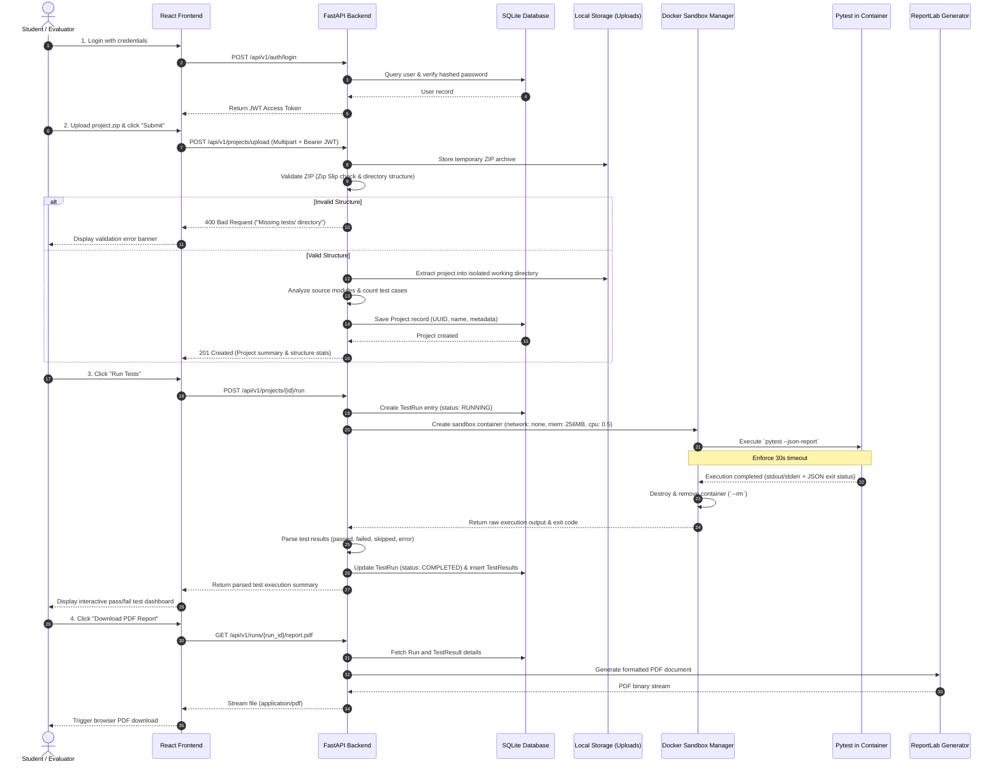

# TestPilot – System Architecture & Design

This document details the architectural layout, component interactions, security sandboxing mechanism, and end-to-end data workflows of **TestPilot**.

---

## 🏛️ 1. High-Level Architecture Overview

TestPilot follows a **modern decoupled Client-Server architecture** with a specialized **Sandboxed Execution Subsystem**.

The system is organized into three primary tiers:
1. **Presentation Tier (React Frontend):** Runs in the user's web browser, providing responsive dashboards for project management, real-time testing feedback, historical run analytics, and report downloads.
2. **Application & Orchestration Tier (FastAPI Backend):** Handles client requests, verifies authentication, validates uploaded archives, parses code metrics, schedules execution, and aggregates test results.
3. **Execution Sandbox Tier (Docker + Pytest):** Completely isolated, disposable Linux containers where untrusted student code is unpacked and executed under strict resource and network constraints.

```
+-----------------------------------------------------------------------+
|                            USER (Browser)                             |
+-----------------------------------------------------------------------+
                                  │
                                  │ HTTP / REST / JSON
                                  ▼
+-----------------------------------------------------------------------+
|                    REACT FRONTEND (Vite + Tailwind)                   |
|  - Auth Views         - Project Upload & Manager     - Test Console  |
|  - Execution History  - Results Inspector            - PDF Viewer    |
+-----------------------------------------------------------------------+
                                  │
                                  │ JSON / Bearer JWT / Multipart Forms
                                  ▼
+-----------------------------------------------------------------------+
|                     FASTAPI BACKEND APPLICATION                       |
|                                                                       |
|  [ Routers & Middleware ]                                             |
|  ├── Auth Router (JWT / OAuth2 Password Bearer)                       |
|  ├── Project Router (ZIP Uploads, Structure Validator)                |
|  ├── Test Execution Router (Docker Invocation, Job Tracker)           |
|  └── Report Router (ReportLab PDF Generation)                         |
|                                                                       |
|  [ Business Logic & Services ]                                        |
|  ├── Archive Service (Zip Slip validation, safe unzipping)            |
|  ├── Code Analyzer (AST / file scanner for functions & tests)         |
|  ├── Docker Manager (Ephemeral container lifecycle & limits)         |
|  └── Pytest Parser (Transforms JSON/JUnit XML into test models)       |
|                                                                       |
|  [ Data Access Layer (SQLAlchemy ORM) ]                               |
+-----------------------------------------------------------------------+
              │                                           │
              ▼                                           ▼
+---------------------------+              +----------------------------+
|      SQLITE DATABASE      |              |   DOCKER SANDBOX ENGINE    |
| - Users                   |              | (Docker Daemon / Docker SDK)
| - Projects                |              |                            |
| - TestRuns                |              |  +----------------------+  |
| - TestResults (Items)     |              |  | Disposable Container |  |
+---------------------------+              |  | - Python 3.11 Slim   |  |
                                           |  | - Pytest installed   |  |
                                           |  | - Read-only project  |  |
                                           |  | - NO network access  |  |
                                           |  | - Memory cap: 256MB  |  |
                                           |  | - CPU cap: 0.5 vCPU  |  |
                                           |  | - Non-root user      |  |
                                           |  +----------------------+  |
                                           +----------------------------+
```

---

## 🧩 2. Core Components & Their Communication

| Component | Responsibility | Inputs / Outputs | Communication Channel |
|---|---|---|---|
| **User (Browser)** | Interacts with UI, uploads files, triggers actions. | Clicks, file selection, credentials. | Browser GUI |
| **React Frontend** | Renders UI, manages client state, routes pages. | Receives API responses; emits requests. | REST API (Fetch/Axios) |
| **FastAPI Backend** | Core REST API gateway and business controller. | JSON payloads, multipart ZIP archives. | ASGI HTTP server (Uvicorn) |
| **Authentication System** | Validates user identity and signs/verifies JWT tokens. | Credentials -> Signed JWT token. | Internal service / Auth router |
| **Project Upload Handler** | Receives binary ZIP streams, enforces size limits, stores temp files. | Multipart form data -> File on disk. | FastAPI File/UploadFile handler |
| **Project Validator** | Inspects archive directory hierarchy (`src/`, `tests/`, etc.). | Unpacked path -> Valid / Invalid verdict. | Python `zipfile` & `os.path` logic |
| **Project Analyzer** | Scans Python modules and discovers Pytest test signatures. | Python files -> Discovered module/test counts. | Python `ast` (Abstract Syntax Trees) |
| **Docker Sandbox Manager** | Spawns, monitors, and cleans up Docker test containers. | Project volume mount -> Process stream output. | Docker Engine API / Docker SDK |
| **Pytest Execution Engine** | Runs inside container; executes test suites and emits results. | `/tests` folder -> stdout, stderr, JSON report. | Container virtualized stdout/stderr |
| **Result Processor** | Parses raw Pytest output into normalized test records. | Raw text/JSON -> `TestResult` database records. | Internal Python parser |
| **Database (SQLite)** | Persists users, projects, runs, and individual test cases. | Structured SQL queries via SQLAlchemy. | SQLite engine connection pool |
| **PDF Report Generator** | Renders formatted PDF testing report with summary tables. | Run ID + Test records -> PDF binary stream. | ReportLab drawing engine |

---

## 📊 3. End-to-End System Workflow (Sequence Diagram)

Below is the complete sequence of events from when a student uploads a project to when a test report is generated and displayed:



---

## 🛡️ 4. Security Sandbox Architecture

Because user code is inherently untrusted, the execution environment implements **defense-in-depth**:

1. **Host Isolation:**
   - The FastAPI backend process never executes student scripts directly (no `exec()`, `eval()`, or `subprocess.run(["python", ...])` on the host).
   - All code is executed inside an ephemeral Docker container.

2. **Filesystem Protection:**
   - The host directory holding the project is mounted into the container as **Read-Only** (`:ro`), or copied into a disposable container layer.
   - Any malicious script attempting `os.remove()` or filesystem wiping will fail to alter the host machine.

3. **Network Isolation:**
   - Started with `--network none`.
   - Prevents code from opening reverse shells, downloading external malware, or attacking local network resources.

4. **Resource Throttling:**
   - `--memory=256m` and `--memory-swap=256m` prevent memory exhaustion.
   - `--cpus=0.5` prevents CPU hogging and denial-of-service against the host.
   - Hard execution timeout (30 seconds) enforced by backend supervisor process.

5. **Privilege De-escalation:**
   - Containers run as an unprivileged user (`UID 1000`), never root.
   - Linux capabilities dropped (`--cap-drop=ALL`).

---

## 🔍 5. Static AST Code Analyzer Subsystem (Day 7)

Before provisioning Docker containers, TestPilot evaluates uploaded projects using a pure static inspection engine (`app.services.project_analyzer`):

1. **Pure In-Memory AST Parsing:**
   - Source code is parsed into abstract syntax trees using Python's standard `ast.parse()`.
   - Never calls `import`, `importlib.import_module()`, `exec()`, or `eval()`.
   - Traps Python syntax errors (`SyntaxError`) statically and returns precise filename, line number, column offset, and compiler error message.

2. **Pytest Candidate Discovery:**
   - Traverses AST nodes to detect candidate test items based on Pytest standard naming conventions:
     - Top-level `ast.FunctionDef` / `ast.AsyncFunctionDef` matching `test_*`.
     - Class definitions `ast.ClassDef` matching `Test*`.
     - Internal class method definitions `test_*`.
   - Ignores helper functions (`helper()`, `setup()`) and application business logic classes.

3. **Dependency and Requirements Inspection:**
   - Inspects `requirements.txt` via static string parsing and regex identifier extraction (PEP 508).
   - Identifies whether `pytest` is declared as a test dependency.
   - Strips inline comments and safely warns about malformed requirement declarations without invoking `pip` or network requests.

4. **Resource Bounds & Symlink Safety:**
   - Traversal via `os.walk(followlinks=False)` ignores symbolic links to prevent filesystem breakout.
   - Traversal filters out Python bytecode cache (`__pycache__`, `.pyc`).
   - Caps individual inspected files at 1 MB (`MAX_INSPECT_FILE_SIZE`) to protect against AST memory bloat.
